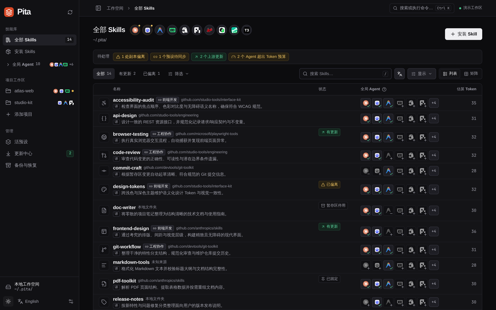
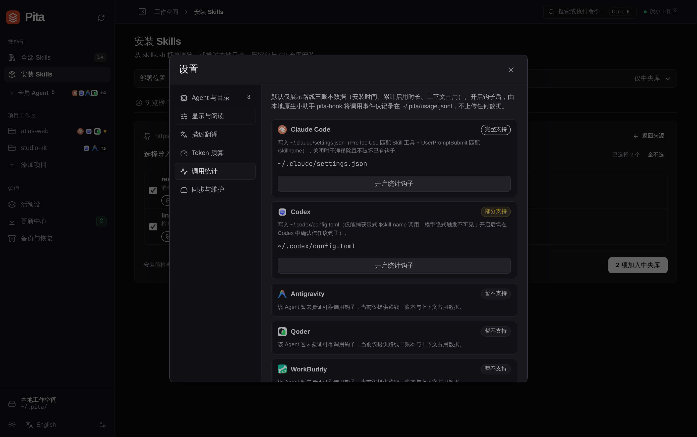
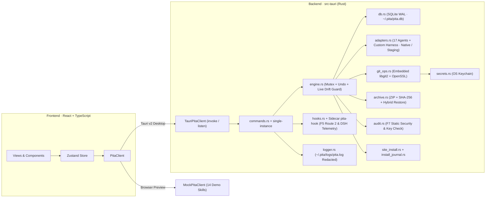

# Pita — Cross-Agent Skills Manager

<p align="center">
  
</p>

<p align="center">
  <strong>把你装在各个 AI Agent 里的 Skills 统一认出来、看得清、开关方便、更新可回滚、换电脑一键恢复。</strong><br />
  A calm, zero-terminal desktop manager for AI coding Agent skills — built with <strong>Tauri v2 + Rust + React + SQLite</strong>.
</p>

<p align="center">
  <a href="https://github.com/Cheese-nya/pita/releases">Releases (v0.3.0)</a> ·
  <a href="CHANGELOG.md">Changelog</a> ·
  <a href="LICENSE">MIT License</a>
</p>

---

## 界面预览（浅色 / 深色双主题）

|                  全部 Skills · 浅色主题                   |                 全部 Skills · 深色主题                  |
| :-------------------------------------------------------: | :-----------------------------------------------------: |
|  |  |

|  F7 安装前安全与凭据检查（支持 `npx skills add owner/repo`）  |        F5 路线二 · Opt-in 调用统计钩子与僵尸清理         |
| :-----------------------------------------------------------: | :------------------------------------------------------: |
|  |  |

---

## 核心特性

- **F1 自动发现与 17-Agent + 自定义 Harness 统一库**：
  - 首次启动自动扫描本机已启用的 Agent 全局目录与注册项目目录（支持 5 层嵌套分组、自动跳过 `.trash`/`node_modules`/`.git`、保护软链接不误删外部仓库）。
  - 内置覆盖 **Claude Code、Codex、Antigravity、DeepSeek Harness (`DSH`)、WorkBuddy、OpenCode、Trae（国际版/中国版）、Hermes Agent、Pi Coding Agent、OpenClaw、Qoder、T3 Code、Gemini CLI、Windsurf、Codex CLI、Claude CLI、Antigravity CLI** 共 17 个 Agent，并支持在「设置 → Agent 与目录」中随时添加 **自定义 Harness**（支持上传自定义 Logo 图标 `PNG`/`SVG`/`JPG`/`WebP`/`ICO`）。
  - 默认按已安装 Agent 优先排序，支持顶部 Token Dock 拖拽排序、6 位直显 / 双环 360° 部署浮层与矩阵刷选视图（Matrix Brush View），并提供 `Ctrl/⌘ K` 全局命令面板与 `J`/`K` 抽屉快捷键导航。
  - 针对 **DeepSeek Harness (`dsh`)** 提供 `$DSH_HOME` / `~/.dsh/skills` 与 `.dsh/skills` 发现、平铺 `<name>.md` 技能启停与移除、Frontmatter 校验与 `.agents/skills` 冲突提示。
- **在线市场浏览与多来源安装（`skills.sh` + Git + 压缩包）**：
  - 「安装 Skills」直连 `skills.sh` 实时榜单（全部 / 趋势 / 热门）与搜索、来源筛选、本地缓存；卡片随视口加载 `SKILL.md` 正文摘要，点击卡片任意位置即可展开右侧预览抽屉并一键安装到指定 Agent 或项目。
  - 支持 Git 仓库 URL、`owner/repo`、`owner/repo@skill`、`npx skills add owner/repo`、GitHub 目录链接、`skills.sh` 链接、站点托管 Skill（`.well-known/agent-skills` / `.well-known/skills`）、本地目录与 `.zip` / `.skill` 压缩包；按锁定 commit 下载文件，冲突时保留原文件并在部署失败时自动回滚局部写入。
- **零漂移中文翻译、字段检索与 Token 估算**：
  - 「全部 Skills」支持按**名称 / 描述 / 来源 / 全部字段**精准检索并高亮匹配文字，搭配滑入式右侧详情抽屉（自动适配系统减少动态效果设置）。
  - 支持通过内置批量 Google 翻译或自定义 OpenAI 兼容 API 一键将 Skill 描述译为简体中文，译文仅保存在 Pita 元数据中，不修改 `SKILL.md` 文件哈希（零 Git 漂移）。
  - 使用 `cl100k_base`（`js-tiktoken`）估算每个 Skill 元数据与 `SKILL.md` 全文 Token 占用，默认按每个 Agent `20,000` Token 预算阈值实时预警。
- **F2 分级停用与可信删除**：
  - **原生配置无损停用**：Claude Code（`~/.claude/settings.json` / `.claude/settings.local.json`）与 Codex（`~/.codex/config.toml` 经 `toml_edit` 保留注释），遇到损坏配置文件时自动中止写入保护原文件。
  - **暂存区停用**：其余内置 Agent 与自定义 Harness 安全移入 `~/.pita/staging/`，停用不丢文件、可随时恢复。
  - **实体拷贝同步（Copy-Sync）**：不做脆弱的软链/Junction，卸载 Pita 后各 Agent 目录下 Skills 依然完整可用；删除确认弹窗明确列出影响目录与 Git 追踪警示。
- **F3 活预设（Live Presets）**：区别于一次性拷贝，修改预设成员后实时计算 `Δ Token` 变化与引用计数差异，自动提醒所有已绑定 Agent/项目一键对齐。
- **F4 先 Diff、后更新、可回滚**：内嵌 `libgit2`（零系统 `git` CLI 依赖），提供全目录树变更文件 Diff 预览、自动更新前快照、一键回滚、固定版本（Pin）；更新前实时复核磁盘副本哈希防止覆盖未扫描的本地个人文件，检查失败或上游路径消失时独立分组如实报错。
- **F5 路线三账本 + 路线二可选调用统计**：
  - 默认仅展示第一手事实账本（安装时间、累计启用时长、上下文 Token 占用估算），**未开启钩子时绝不冒充调用次数**。
  - 开启 Opt-in 钩子后，由随包分发的零 Shell 依赖原生小助手 `pita-hook` 将事件仅写入 `~/.pita/usage.jsonl`（支持 Claude Code `PreToolUse` + `UserPromptSubmit`、Codex `UserPromptSubmit` 显式 `$skill` / `/skill` 调用与信任门引导）；支持以只读增量方式解析 `~/.dsh/sessions/`（`.jsonl` / `.jsonl.zstd`）记录 DSH 调用统计；关闭钩子时精准移除配置且不破坏用户自有规则，可自选保留或清空历史，并支持一键停用长期未调用的僵尸 Skills。
- **F6 & F8 混合清单包与多设备冲突合并**：导出 `skills-lock.json` v1 + `local-skills/` ZIP 套装包（SHA-256 校验、防 Zip-Slip），支持 GitHub PAT 一键连接远端备份仓库与新机一键恢复（OS Keychain 隔离凭据），冲突项逐条提供「采用远端 / 保留本机」与 Diff 对比，绝不静默覆盖。
- **F7 安装前安全与凭据审计**：安装前自动检测 API Key/OAuth 依赖、可执行脚本/Shebang 与高危 Shell/外传命令（安全 / 提示 / 高风险徽章 + 文件级详情）。

---

## 首次运行说明（未签名开源构建 · 零终端）

开源桌面安装包当前未购买商业代码签名证书，可从 [GitHub Releases](https://github.com/Cheese-nya/pita/releases) 下载对应平台最新安装包（当前最新版本为 **`v0.3.0`**）。首次启动如遇系统安全提示，按以下图形步骤一次放行即可，**全程无需打开终端**：

- **Windows（SmartScreen 提示「Windows 已保护你的电脑」）**：
  1. 点击弹窗中的 **「更多信息（More info）」**；
  2. 点击底部出现的 **「仍要运行（Run anyway）」** 即可正常启动。
- **macOS（Gatekeeper 提示「无法验证开发者」）**：
  1. 在「应用程序」中 **右键点击 `Pita.app` → 选择「打开」**；
  2. 或打开 **系统设置 → 隐私与安全性**，在底部点击 **「仍要打开」** 放行。
- **Linux**：
  - Debian / Ubuntu：`sudo apt install ./Pita_0.3.0_amd64.deb`（同时自动安装 `/usr/bin/pita` 与 `/usr/bin/pita-hook`）。

---

## 架构边界



---

## 本地开发与构建

环境要求：**Node.js 22+**、**Rust 1.78+**（Linux 需安装 `libwebkit2gtk-4.1-dev`、`libappindicator3-dev`、`librsvg2-dev`、`patchelf`、`libssl-dev`、`pkg-config`）。

```bash
# 安装前端依赖
npm ci

# 1. 浏览器演示模式（Mock 工作区，14 条内置演示 Skills）
npm run dev

# 2. Tauri 桌面开发模式（真实本机扫描与 ~/.pita/pita.db）
npm run build:sidecar
npm run tauri:dev

# 3. 生产构建与全量校验
npm run build
npm run build:sidecar
cargo clippy --manifest-path src-tauri/pita-hook/Cargo.toml --all-targets -- -D warnings
cargo test --manifest-path src-tauri/pita-hook/Cargo.toml
cargo clippy --manifest-path src-tauri/Cargo.toml --all-targets -- -D warnings
cargo test --manifest-path src-tauri/Cargo.toml

# 4. 打包桌面安装包（自动编译前端 + pita-hook sidecar + 安装包）
npm run tauri:build
```

---

## 开源协议

基于 [MIT License](LICENSE) 开源发布。详见 [CHANGELOG.md](CHANGELOG.md)。
